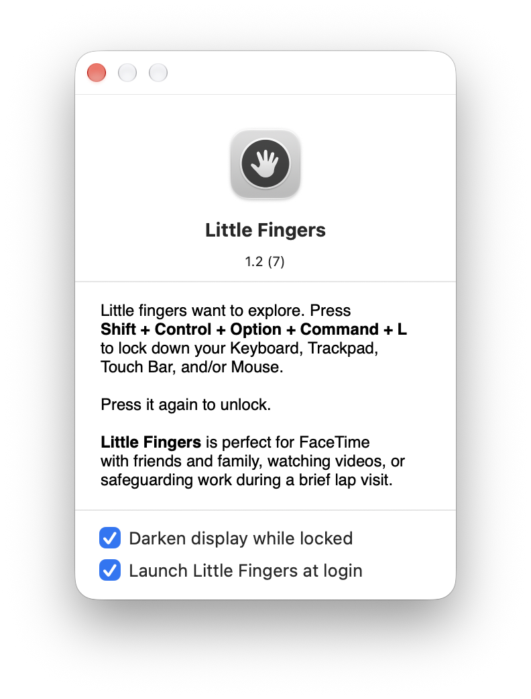

# Little Fingers

Little fingers want to explore. Little Fingers is a small macOS menu-bar app that locks your keyboard, trackpad, Touch Bar and mouse with one shortcut. It's handy for FaceTime with family, watching videos, or protecting your work while a child sits on your lap.

Originally written by [Shaun Inman](https://github.com/shauninman/Little-Fingers) in 2017. This fork (version 1.2) updates it to build with current Xcode (Swift 5, macOS 12+) and adds a display-darkening mode, a Credits window and clearer handling of the Accessibility permission.

<p align="center">
  
</p>

## Usage

Press **⌃ Control + ⌥ Option + ⇧ Shift + ⌘ Command + L** to lock all input. Press it again to unlock.

- The menu-bar icon shows whether input is locked.
- The lock pauses on its own when the screensaver starts, the screen locks, or a shutdown or logout begins.
- The app has no Dock icon. Use the menu-bar item to open **About** (with options for **Darken display while locked** and **Launch at login**), **Credits**, or to quit.
- With **Darken display while locked** turned on, all screens turn black while locked and the cursor is hidden. That's handy for cleaning the display. A dim hint in the middle of each screen shows the shortcut to unlock.

> **Note:** The `L` key is matched by its physical key code, which is where `L` sits on a US layout. On other keyboard layouts the shortcut may be a different key.

## Requirements

- macOS 12 or later
- **Accessibility** permission, which the app needs to intercept input

The first time you launch it, macOS asks for Accessibility access. Allow it under **System Settings → Privacy & Security → Accessibility**. Little Fingers restarts itself once access is granted. If you press the shortcut while access is missing, Little Fingers shows an alert with a button that opens the Accessibility settings.

## Building

You need Xcode with its command-line tools. There are no third-party dependencies.

```bash
make            # Release build
make debug      # Debug build
make run        # build and launch
make install    # build and copy to /Applications (override with INSTALL_DIR=…)
make uninstall  # remove from /Applications
make zip        # build and package as build/Little-Fingers.zip
make clean      # remove build artifacts
make signing-cert  # create the local signing certificate (once)
```

The built app lands in `build/DerivedData/Build/Products/<Configuration>/Little Fingers.app`. You can also open `Little Fingers.xcodeproj` in Xcode and run the **Little Fingers** scheme.

### Code signing and Accessibility

macOS ties the Accessibility permission to the app's code signature. To keep the permission across rebuilds, create a local signing certificate once:

```bash
make signing-cert
```

From then on, `make` signs every build with that certificate, so you only grant Accessibility once. Without the certificate the app is signed ad hoc. Every rebuild then looks like a new app to macOS, and you have to remove Little Fingers from the Accessibility list and grant access again.

## How it works

`TapController.m` installs two `CGEventTap`s. One listens for the lock shortcut. The other swallows every input event while the Mac is locked. `StatusItemController.swift` manages the menu-bar item, the About and Credits windows, and the black overlay for darkening the display, and `LoginItems.m` handles launch at login.

## Credits

- [Shaun Inman](https://github.com/shauninman): original author, versions up to 1.1. All original rights belong to him.
- [Dr.-Ing. Sergej Görzen](https://github.com/SGoerzen): version 1.2
